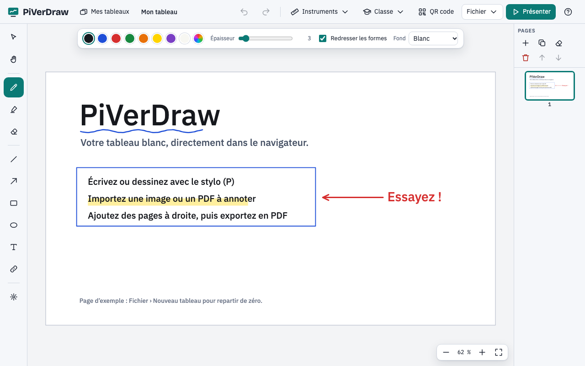

# PiVerDraw

**Une application pour utiliser son TBI/ENI en classe** : un tableau blanc dans le navigateur, pensé pour le tableau interactif, l’ordinateur, la tablette et le téléphone, à la souris, au doigt ou au stylet.

👉 **Ouvrir PiVerDraw : https://pivertice.github.io/**

Gratuit, sans compte, sans publicité. Une fois installé, il fonctionne **sans internet**.



---

## Sommaire

1. [Installer l’application](#1-installer-lapplication)
2. [Premiers pas](#2-premiers-pas)
3. [Les outils](#3-les-outils)
4. [Sélectionner, déplacer, agrandir, pivoter](#4-sélectionner-déplacer-agrandir-pivoter)
5. [Pages et fonds](#5-pages-et-fonds)
6. [Instruments de géométrie](#6-instruments-de-géométrie)
7. [Outils de classe](#7-outils-de-classe)
8. [QR code et liens cliquables](#8-qr-code-et-liens-cliquables)
9. [Mode présentation](#9-mode-présentation)
10. [Importer, exporter, enregistrer](#10-importer-exporter-enregistrer)
11. [Hors ligne et mises à jour](#11-hors-ligne-et-mises-à-jour)
12. [Données des élèves](#12-données-des-élèves)
13. [Raccourcis clavier](#13-raccourcis-clavier)
14. [Questions fréquentes](#14-questions-fréquentes)
15. [Pour les développeurs](#15-pour-les-développeurs)

---

## 1. Installer l’application

On peut utiliser PiVerDraw directement dans le navigateur, mais l’installer est conseillé : il s’ouvre dans sa propre fenêtre, fonctionne hors ligne et vos tableaux sont mieux protégés.

| Appareil | Comment faire |
|---|---|
| **Ordinateur (Chrome, Edge)** | Menu **Fichier › Installer l’application…**, puis confirmer. |
| **Mac (Safari)** | Menu **Fichier** de Safari › **Ajouter au Dock…** (macOS 14 Sonoma ou plus récent). |
| **Android (Chrome)** | Menu **Fichier › Installer l’application…**, puis confirmer : l’icône arrive sur l’écran d’accueil. |
| **iPhone, iPad (Safari)** | Bouton **Partager** › **Sur l’écran d’accueil** › **Ajouter**. |

Dans PiVerDraw, **Fichier › Installer l’application…** rappelle ces étapes pour votre appareil.

## 2. Premiers pas

- Choisissez un outil dans la **barre d’outils** (à gauche sur ordinateur, en bas sur téléphone).
- La **barre de réglages** en haut change selon l’outil : couleur, épaisseur, fond de page…
- **Annuler** : flèche ↶ en haut, ou **Ctrl+Z** (Cmd+Z sur Mac). Chaque geste s’annule en une fois.
- Le tableau est **enregistré tout seul** dans l’appareil, à chaque modification.
- La page d’exemple s’efface avec **Fichier › Nouveau tableau**.
- Le bouton **?** en haut à droite affiche tous les raccourcis.

## 3. Les outils

| Outil | Touche | À savoir |
|---|---|---|
| **Sélectionner** | V | Voir [section 4](#4-sélectionner-déplacer-agrandir-pivoter). |
| **Déplacer la page** | M ou Espace | Fait glisser la vue. Avec deux doigts : déplacer et zoomer. |
| **Stylo** | P | Sensible à la pression du stylet. Maj : trait droit (angles de 15°). |
| **Surligneur** | H | Couleur transparente. |
| **Gomme** | E | Deux modes : **Partie** (efface seulement ce qui est touché) ou **Trait entier**. |
| **Ligne, Flèche** | L, A | Maj : angles de 15°. |
| **Rectangle, Ellipse** | R, O | Remplissage possible. Maj : carré, cercle. |
| **Texte** | T | Cliquer puis écrire ; Échap ou Ctrl+Entrée pour valider. |
| **Pointeur laser** | K | Trace lumineuse qui s’efface seule ; durée réglable. |

**Écriture à la main** : les traits écrits à la suite (moins de 1,5 s entre deux traits) et proches les uns des autres forment un **groupe**. Un mot ou une courte phrase se sélectionne et se déplace donc d’un bloc. Pour les séparer : **Dégrouper** (Ctrl+G).

**Redresser les formes** : en fin de trait, gardez la pointe immobile un instant : PiVerDraw remplace le tracé par une droite, un cercle, un rectangle ou un triangle propre. L’option se coupe dans la barre de réglages du stylo.

## 4. Sélectionner, déplacer, agrandir, pivoter

Avec l’outil **Sélectionner** (V) :

- **Cliquer** sur un objet le sélectionne ; **glisser** dans le vide trace un cadre qui sélectionne plusieurs objets ; **Maj + clic** ajoute ou retire un objet.
- **Glisser** l’objet le déplace.
- Le **petit carré** au coin du cadre **agrandit ou réduit**.
- La **poignée ronde** au-dessus du cadre **fait pivoter**. Maj : par pas de 15°. Un léger aimant arrête l’objet à 0°, 90°, 180° et 270°.
- Le cadre de sélection **pivote avec l’objet** et l’**angle** reste affiché (par exemple « 45° »).
- Bouton **↻** : pivoter de 90°. Bouton **0°** (visible quand l’objet est tourné) : **revenir à la position de départ**.

Dans la barre de sélection :

| Bouton | Effet |
|---|---|
| Dupliquer | Copie à côté (Ctrl+D). |
| Mettre devant / derrière | Ordre des objets. |
| Grouper / Dégrouper | Les objets groupés se sélectionnent et se déplacent ensemble (Ctrl+G). |
| Verrouiller 🔒 | L’objet ne bouge plus et ne se sélectionne plus (pratique pour un fond ou une consigne). « Déverrouiller » apparaît dans la barre quand rien n’est sélectionné. |
| Copies illimitées ∞ | Glisser l’objet en tire une copie à chaque fois (étiquettes, jetons…). Alt + glisser déplace l’original. |
| Redresser | Transforme un tracé à main levée en forme propre. |
| Lien… | Rend un texte ou une image cliquable (Ctrl+K). |
| Supprimer | Touche Suppr. |

## 5. Pages et fonds

- Le **panneau des pages** (à droite, ou en bas sur téléphone) permet d’**ajouter**, **dupliquer**, **effacer**, **supprimer** et **réordonner** les pages. Ctrl+Entrée ajoute une page ; PgUp / PgDn changent de page.
- **Effacer la page** (bouton gomme du panneau des pages) vide la page d’un coup. Les objets verrouillés restent. Ctrl+Z annule.
- **Fond de page** (barre de réglages) : blanc, quadrillé, lignes, Seyès, points ou tableau noir.
- On peut écrire en dehors du cadre de la page : les exports englobent tout.

## 6. Instruments de géométrie

Menu **Instruments** : règle graduée (30 cm), équerre 45°, équerre 30°-60°, rapporteur 180° et compas.

- Faites glisser un instrument pour le déplacer ; tirez son extrémité pour le tourner.
- Avec le **stylo près d’un bord**, le trait suit l’instrument.
- **Compas** : Maj + glisser la pointe pour le faire pivoter sans tracer.
- **Tout masquer** range les instruments.

## 7. Outils de classe

Menu **Classe** : des fenêtres flottantes que l’on peut déplacer.

- **Minuteur** : durée réglable, son facultatif ; la fenêtre revient à l’écran à la fin.
- **Tirage au sort** : collez la liste de la classe (un nom par ligne, ou séparés par des virgules), marquez les absents, tirez un élève (chacun une fois) ou formez des **groupes**.
- **Rideau** : cache une partie de la page pour la dévoiler petit à petit.

## 8. QR code et liens cliquables

- Bouton **QR code** : collez une adresse (exercice, vidéo, site…) ; couleurs, fond transparent, libellé sous le code, QR cliquable. Le QR se place sur la page comme une image.
- **Liens** : sélectionnez un texte ou une image puis **Ctrl+K** (ou « Lien… »). **Ctrl+clic** ouvre le lien ; en mode présentation, un simple clic suffit. Les liens restent cliquables dans le PDF exporté.

## 9. Mode présentation

Bouton **Présenter** : plein écran, sans menus, avec une petite barre (stylo, gomme, laser, main, sélection, page précédente / suivante). **Échap** pour quitter.

## 10. Importer, exporter, enregistrer

Menu **Fichier** :

| Commande | Usage |
|---|---|
| Mes tableaux… | Tous les tableaux enregistrés dans cet appareil : ouvrir, renommer, supprimer. |
| Nouveau tableau | Le tableau actuel reste dans « Mes tableaux ». |
| Importer › Images… | Ajoute des images (aussi par glisser-déposer ou copier-coller). |
| Importer › PDF à annoter… | Chaque page du PDF devient une page verrouillée sur laquelle écrire. |
| Page en cours en PNG | Image de la page. |
| Toutes les pages en PDF | À imprimer ou à partager avec les élèves. |
| Exporter ce tableau (.json) | Sauvegarde complète, modifiable plus tard. |
| Importer un projet (.json)… | Rouvre une sauvegarde (les anciens fichiers `.ardoise.json` fonctionnent aussi). |

⚠️ **Les tableaux sont enregistrés dans l’appareil et le navigateur utilisés**, pas en ligne. Pour passer d’un appareil à un autre : **Exporter ce tableau (.json)** sur le premier, puis **Importer un projet** sur le second. Pensez à exporter de temps en temps vos tableaux importants.

## 11. Hors ligne et mises à jour

- Une fois ouverte une première fois (et de préférence installée), l’application fonctionne **sans connexion**, import de PDF et QR code compris.
- Quand une nouvelle version est publiée, un bandeau **« Une nouvelle version de PiVerDraw est prête »** apparaît : **Recharger** enregistre votre tableau puis passe à la nouvelle version.

## 12. Données des élèves

Les listes de classe du tirage au sort et tous vos tableaux restent **uniquement dans votre appareil**. PiVerDraw n’envoie rien sur internet : pas de compte, pas de serveur, pas de statistiques, aucune requête vers un autre site.

## 13. Raccourcis clavier

Sur Mac, **Ctrl** = **Cmd**.

| Action | Raccourci |
|---|---|
| Outils | V sélection · M main · P stylo · H surligneur · E gomme · L ligne · A flèche · R rectangle · O ellipse · T texte · K laser |
| Annuler · Rétablir | Ctrl+Z · Ctrl+Y |
| Copier · Coller · Dupliquer | Ctrl+C · Ctrl+V · Ctrl+D |
| Tout sélectionner · Supprimer | Ctrl+A · Suppr |
| Grouper / Dégrouper | Ctrl+G |
| Lien cliquable · l’ouvrir | Ctrl+K · Ctrl+clic |
| Zoom · Ajuster | Ctrl + molette, + / − · 0 |
| Pages | PgUp / PgDn · Ctrl+Entrée (nouvelle page) |
| Annuler un geste, désélectionner, quitter la présentation | Échap |

## 14. Questions fréquentes

**Je ne vois pas une nouveauté annoncée.** Rechargez la page (ou fermez et rouvrez l’application) une ou deux fois. Ensuite, le bandeau « nouvelle version » s’en charge.

**Je ne trouve pas « Installer l’application ».** Sur Safari pour Mac, passez par le menu Fichier de Safari › Ajouter au Dock. Si l’option n’existe pas (macOS antérieur à Sonoma), utilisez Chrome ou Edge.

**Mes tableaux ont disparu sur un autre appareil.** C’est normal : ils restent dans l’appareil où ils ont été créés (voir [section 10](#10-importer-exporter-enregistrer)).

**J’ai effacé quelque chose par erreur.** Ctrl+Z, ou la flèche ↶ en haut.

**J’utilisais l’ancienne adresse (pierreverbiest.github.io/piverdraw).** PiVerDraw a déménagé à **https://pivertice.github.io/**. Les tableaux enregistrés à l’ancienne adresse ne suivent pas automatiquement : si l’application déjà installée s’ouvre encore (hors ligne), utilisez **Fichier › Exporter ce tableau (.json)** pour chaque tableau à garder, puis **Importer un projet** dans la nouvelle version, et installez l’application depuis la nouvelle adresse.

---

## 15. Pour les développeurs

- Toute l’application est dans [`site/`](site/) : un seul fichier [`site/index.html`](site/index.html) (HTML, CSS, JavaScript, sans framework ni compilation), un service worker pour le hors ligne, et des bibliothèques locales (pdf.js, qrcode-generator).
- Chaque envoi sur `main` publie `site/` sur GitHub Pages (`.github/workflows/pages.yml`).
- Architecture, règles à respecter et méthode de travail : [`CLAUDE.md`](CLAUDE.md).

```bash
npm install
npx playwright install chromium
npm run serve               # http://localhost:8080
npm test                    # tous les tests automatiques
python3 outils/bump_sw.py   # après toute modification de site/, avant de publier
```

**Licences des composants** : polices IBM Plex et Bricolage Grotesque (SIL Open Font License), pdf.js (Mozilla, Apache 2.0), qrcode-generator (MIT) ; les textes des licences sont dans `site/fonts/` et `site/vendor/`.
